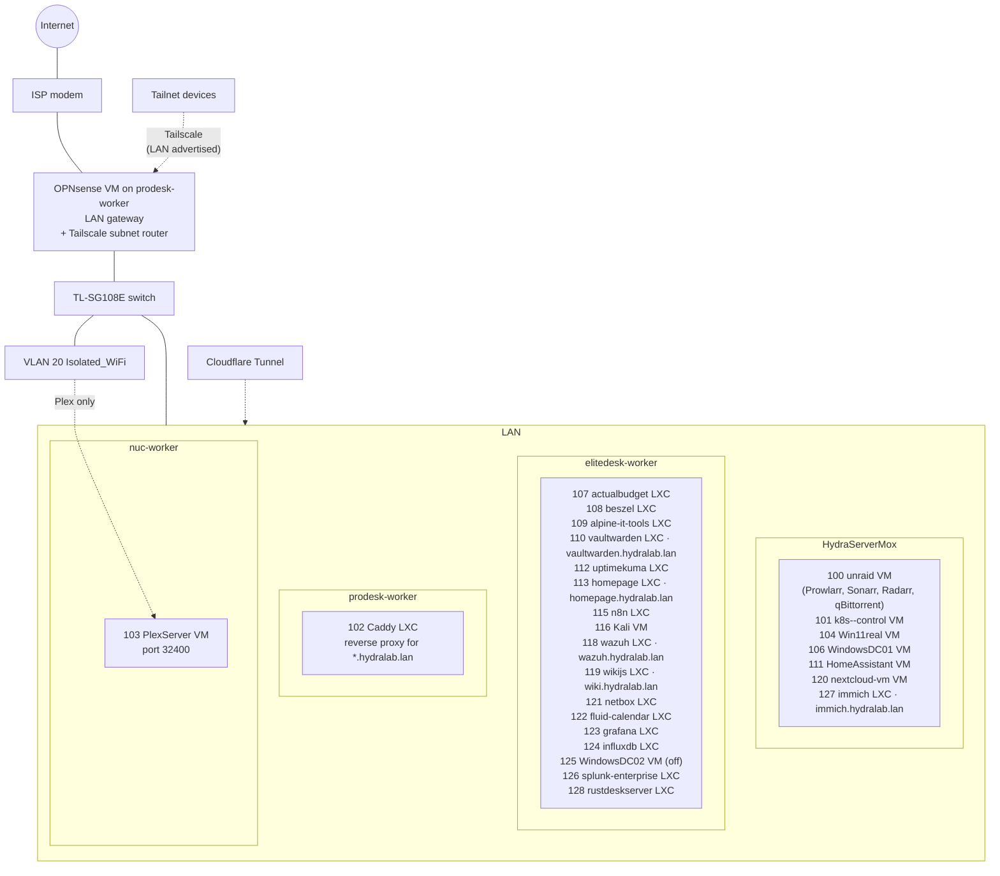

# HydraLab

Personal homelab: a 4-node Proxmox VE cluster running routing, security monitoring, identity, remote access, and a media stack. This repo is the documentation of record: how things are built, why, and how to change them safely.

> **Public documentation.** Hostnames and topology only. Internal IPs are written as placeholders such as `<plex-ip>`, and no passwords, keys, or tokens are stored here (see [`.gitignore`](.gitignore)).

---

## At a glance

| | |
|---|---|
| **Hypervisor** | Proxmox VE, 4-node cluster with ZFS storage |
| **Nodes** | `HydraServerMox`, `nuc-worker`, `prodesk-worker`, `elitedesk-worker` |
| **Router/firewall** | OPNsense VM, ISP WAN |
| **Switch** | TP-Link TL-SG108E v6 (802.1Q) |
| **LAN** | Flat LAN plus isolated VLANs (see [docs/networking](docs/networking/README.md)) |
| **Local domain** | `hydralab.lan`: Unbound host overrides point web UIs at a Caddy reverse proxy with an internal CA (see [Reverse proxy](docs/networking/reverse-proxy.md)) |
| **Remote access** | Tailscale (subnet routing), Cloudflare Tunnel |
| **Passwords** | Vaultwarden at `vaultwarden.hydralab.lan` |
| **Security** | Wazuh SIEM at `https://wazuh.hydralab.lan` |
| **Identity** | Active Directory lab, `HYDRALAB` domain |
| **Media** | Plex (QuickSync on the NUC) at `<plex-ip>:32400`, *arr stack, qBittorrent over PIA VPN |

## Architecture

Every guest with its ID and notes is in the [Services list](docs/proxmox/README.md#services).

## Repo map

| Path | What's in it |
|---|---|
| [`docs/proxmox/`](docs/proxmox/README.md) | Cluster nodes, every VM/LXC with its port, storage, migration from Unraid, [monitoring](docs/proxmox/monitoring.md) (InfluxDB + Grafana, dashboards) |
| [`docs/networking/`](docs/networking/README.md) | OPNsense, switch, addressing plan, firewall philosophy, Caddy reverse proxy and internal CA |
| [`docs/networking/vlans/`](docs/networking/vlans/README.md) | **One doc per VLAN.** Start here to add a new segment |
| [`docs/dns/`](docs/dns/README.md) | Unbound, `hydralab.lan` overrides, Pi-hole history |
| [`docs/remote-access/`](docs/remote-access/README.md) | Tailscale, Cloudflare Tunnel, RustDesk server |
| `docs/security/` | [Wazuh](docs/security/wazuh.md) SIEM, agent enrollment, [Vaultwarden](docs/security/vaultwarden.md) password manager, [SSH access](docs/security/ssh-access.md) |
| `docs/identity/` | [Active Directory lab](docs/identity/active-directory.md) |
| [`docs/media/`](docs/media/README.md) | Plex, Immich, *arr stack, download client |
| `docs/dashboard/` | [Homepage dashboard](docs/dashboard/homepage.md) config |
| [`docs/projects/`](docs/projects/README.md) | Exploratory lab projects and design notes |
| [`runbooks/`](runbooks/README.md) | Step-by-step procedures (add a VLAN, add a node, etc.) |
| [`templates/`](templates/) | Copy these when documenting a new service or VLAN |
| `mkdocs.yml`, `scripts/build-site.sh`, `wrangler.jsonc` | Builds these docs as a website (MkDocs Material), served by a Cloudflare Worker |
| [`CHANGELOG.md`](CHANGELOG.md) | Dated log of notable changes |
