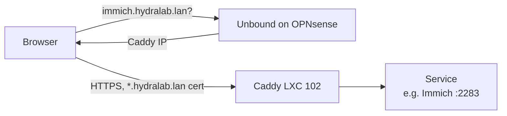

# Reverse proxy (Caddy) and internal CA

| | |
|---|---|
| **Purpose** | HTTPS by name for web UIs (`https://immich.hydralab.lan` instead of `http://<immich-ip>:2283`) |
| **Runs on** | LXC `102` (`Caddy`) on `prodesk-worker` |
| **IP / port** | `<caddy-ip>`, ports `80` (redirects to HTTPS) and `443` |
| **Hostname** | One per proxied service, see [Proxied services](#proxied-services) |
| **Version** | Caddy 2, from Caddy's official apt repo |
| **Config** | `/etc/caddy/Caddyfile`; cert and key in `/etc/caddy/certs/` |
| **Backups** | TODO: |
| **Credentials** | `<see password manager>` |

TODO: LXC resources and OS (`pct config 102` on `prodesk-worker`).

## How it fits together



- **Unbound stays the DNS server.** Each proxied name is an Unbound host override pointing at Caddy. See [DNS](../dns/README.md#hydralablan-overrides).
- **The OPNsense GUI is also reachable directly** at `http://<opnsense-ip>`, so the firewall can still be managed if Caddy or DNS is down.
- **OPNsense must list `opnsense.hydralab.lan`** under **System → Settings → Administration → Alternate Hostnames**, or it rejects proxied requests with a DNS rebind / HTTP_REFERER error.
- If Caddy is down, every service still works at its IP and port; only the names stop loading.

## Proxied services

| URL | Upstream | Upstream TLS |
|---|---|---|
| `https://hydraserver.hydralab.lan` | `<hydraserver-ip>:8006` | Self-signed, not verified |
| `https://nuc.hydralab.lan` | `<nuc-ip>:8006` | Self-signed, not verified |
| `https://prodesk.hydralab.lan` | `<prodesk-ip>:8006` | Self-signed, not verified |
| `https://elitedesk.hydralab.lan` | `<elitedesk-ip>:8006` | Self-signed, not verified |
| `https://wazuh.hydralab.lan` | `<wazuh-ip>:443` | Self-signed, not verified |
| `https://immich.hydralab.lan` | `<immich-ip>:2283` | Plain HTTP |
| `https://wiki.hydralab.lan` | `<wiki-ip>:3000` | Plain HTTP |
| `https://vaultwarden.hydralab.lan` | `<vaultwarden-ip>:8000` | Self-signed, not verified |
| `https://homepage.hydralab.lan` | `<homepage-ip>:3000` | Plain HTTP |
| `https://opnsense.hydralab.lan` | `<opnsense-ip>:80` | Plain HTTP |
| `https://grafana.hydralab.lan` | `<grafana-ip>:3000` | Plain HTTP |
| `https://influxdb.hydralab.lan` | `<influxdb-ip>:8086` | Plain HTTP |
| `https://splunk.hydralab.lan` | `<splunk-ip>:8000` | Plain HTTP |

**These names are for web UIs only.** They resolve to Caddy, not to the host:

- SSH to Proxmox nodes by IP. `ssh root@hydraserver.hydralab.lan` reaches the Caddy LXC.
- Wazuh agents must report to `<wazuh-ip>`. Caddy only carries 80/443, not `1514`/`1515`.

Not proxied: Plex (apps use `plex.direct`), Unraid.

## Certificates

Both are managed in OPNsense under **System → Trust**. Caddy holds a copy of the wildcard cert and key; OPNsense lists it as not in use, which is expected.

| Cert | Subject | Key | Valid until |
|---|---|---|---|
| `HydraLab Root CA` (Authorities) | `CN=HydraLab Root CA`, `O=HydraLab` | RSA-2048 | 2036-10-27 |
| `hydralab.lan wildcard` (Certificates) | `CN=*.hydralab.lan`, SANs `*.hydralab.lan`, `hydralab.lan`; server auth | RSA-2048 | **2027-11-30** |

**The wildcard cert must be reissued before 2027-11-30** (397-day lifetime, the limit Apple devices accept). Issue a new one from the same CA and replace the two files on Caddy; devices that trust the CA need no changes.

### Devices trusting the CA

Node.js tools such as the Bitwarden CLI ignore the system store; they need `NODE_EXTRA_CA_CERTS` set to the system CA bundle.


| Device | Method | Status |
|---|---|---|
| Main PC (Fedora) | `/etc/pki/ca-trust/source/anchors/hydralab-root-ca.crt` | Done |
| `E16` laptop (Arch) | `trust anchor --store` (p11-kit system store) | Done |
| Phones | Manual install | TODO: |

## Caddyfile

```
(hydralab_tls) {
    tls /etc/caddy/certs/hydralab.crt /etc/caddy/certs/hydralab.key
}

# Upstream uses a self-signed HTTPS cert (Proxmox, Wazuh, Vaultwarden)
(https_upstream) {
    reverse_proxy https://{args[0]} {
        transport http {
            tls_insecure_skip_verify
        }
    }
}

hydraserver.hydralab.lan {
    import hydralab_tls
    import https_upstream <hydraserver-ip>:8006
}

nuc.hydralab.lan {
    import hydralab_tls
    import https_upstream <nuc-ip>:8006
}

prodesk.hydralab.lan {
    import hydralab_tls
    import https_upstream <prodesk-ip>:8006
}

elitedesk.hydralab.lan {
    import hydralab_tls
    import https_upstream <elitedesk-ip>:8006
}

wazuh.hydralab.lan {
    import hydralab_tls
    import https_upstream <wazuh-ip>:443
}

immich.hydralab.lan {
    import hydralab_tls
    reverse_proxy <immich-ip>:2283
}

wiki.hydralab.lan {
    import hydralab_tls
    reverse_proxy <wiki-ip>:3000
}

vaultwarden.hydralab.lan {
    import hydralab_tls
    import https_upstream <vaultwarden-ip>:8000
}

homepage.hydralab.lan {
    import hydralab_tls
    reverse_proxy <homepage-ip>:3000
}

opnsense.hydralab.lan {
    import hydralab_tls
    reverse_proxy <opnsense-ip>:80
}

grafana.hydralab.lan {
    import hydralab_tls
    reverse_proxy <grafana-ip>:3000
}

influxdb.hydralab.lan {
    import hydralab_tls
    reverse_proxy <influxdb-ip>:8086
}

splunk.hydralab.lan {
    import hydralab_tls
    reverse_proxy <splunk-ip>:8000
}
```

## Adding a service

1. Add a site block to the Caddyfile (`reverse_proxy` for HTTP upstreams, `import https_upstream` for self-signed HTTPS ones).
2. Add an Unbound host override: `<name>.hydralab.lan` → `<caddy-ip>`, **Add PTR record** off.
3. Add a row to [Proxied services](#proxied-services) and to the [DNS overrides](../dns/README.md#hydralablan-overrides).

## Useful commands

On the Caddy LXC:

| Command | What it does |
|---|---|
| `caddy validate --config /etc/caddy/Caddyfile` | Checks the Caddyfile for errors without applying it |
| `systemctl reload caddy` | Applies the Caddyfile with no downtime |
| `systemctl is-active caddy` | Prints `active` if Caddy is running |
| `journalctl -u caddy -f` | Follows Caddy's log |
| `openssl x509 -in /etc/caddy/certs/hydralab.crt -noout -subject -ext subjectAltName -enddate` | Shows the cert's names and expiry date |

From a client:

| Command | What it does |
|---|---|
| `dig @<opnsense-ip> immich.hydralab.lan +short` | Asks Unbound directly; should print `<caddy-ip>` |
| `resolvectl flush-caches` | Clears the PC's DNS cache (Linux) after an override changes |
| `curl -sI https://immich.hydralab.lan` | Fetches the page headers; fails with a cert error if the CA isn't trusted |
