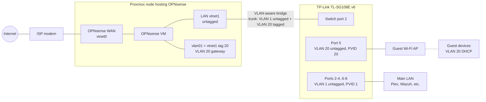

# HydraLab: Isolated WiFi VLAN (VLAN 20)

Guest WiFi that can reach the internet and Plex, and nothing else on the internal network.

> **Updated 2026-10-28:** the ISP changed, and the OPNsense trunk is switch port 2 (`prodesk-worker`), not port 1. Steps below use port 2. Verification results are from the original 2026-10-07 setup.

| | |
|---|---|
| **Completed** | 2026-10-07 |
| **Access point** | Standalone consumer Wi-Fi satellite on a dedicated switch port |
| **VLAN** | 20 (`Isolated_WiFi`) |
| **Subnet** | `<vlan20-subnet>` |
| **Only internal host reachable** | Plex at `<plex-ip>:32400` |

---

## Contents

1. [Goal](#goal)
2. [Topology](#topology)
3. [Components](#components)
4. [Addressing](#addressing)
5. [Configuration by layer](#configuration-by-layer)
   - [TP-Link switch](#1-tp-link-tl-sg108e-switch)
   - [Proxmox bridge](#2-proxmox-bridge)
   - [OPNsense](#3-opnsense)
   - [Plex](#4-plex)
6. [Verification](#verification)
7. [Troubleshooting a VLAN, layer by layer](#troubleshooting-a-vlan-layer-by-layer)
8. [Runbook: adding another VLAN](#runbook-adding-another-vlan)
9. [Possible future work](#possible-future-work)

---

## Goal

Add a WiFi network for guests and untrusted devices that:

- Gets internet access
- Can stream from Plex
- **Cannot** reach anything else internal (OPNsense GUI, Proxmox, Wazuh, other LXCs and VMs, the main LAN)
- Requires each Plex user to sign in with their own account and see only the libraries shared with them

---

## Topology



**Traffic path for a guest device:** phone → guest Wi-Fi → switch port 5 (untagged, tagged as VLAN 20 on entry) → port 2 (leaves tagged 20) → Proxmox VLAN-aware bridge → OPNsense `vlan01` → firewall rules → internet, or Plex only.

---

## Components

| Component | Details | Role |
|---|---|---|
| Switch | TP-Link TL-SG108E v6 (Easy Smart) | 802.1Q tagging. Port 2 = trunk to OPNsense node (`prodesk-worker`), port 5 = Orbi |
| Access point | Consumer Wi-Fi satellite (standalone) | Bridges WiFi clients onto port 5 |
| Hypervisor | Proxmox VE (HydraLab cluster) | VLAN-aware Linux bridge carries tagged traffic to the OPNsense VM |
| Firewall/router | OPNsense VM. WAN = `vtnet0`, LAN = `vtnet1` | VLAN interface, DHCP (Dnsmasq), DNS (Unbound), firewall rules |
| DHCP | Dnsmasq DNS & DHCP (DNS listener on 53053, DHCP only) | Hands out `<vlan20-dhcp-range>` |
| DNS | Unbound on port 53 | Resolver for all VLANs. Rebind exception for `plex.direct` |
| Plex | VM at `<plex-ip>` (Intel QuickSync on the NUC) | The only internal service guests can reach |

---

## Addressing

| Network | VLAN | Subnet | Gateway / DNS | DHCP range | Switch ports |
|---|---|---|---|---|---|
| LAN | 1 (untagged) | `<lan-subnet>` | `<opnsense-ip>` | (existing) | 1-4, 6-8 |
| Isolated_WiFi | 20 | `<vlan20-subnet>` | `<vlan20-gateway>` | `<vlan20-dhcp-range>` | 5 (untagged), 1 (tagged) |

Convention for future VLANs: each VLAN gets its own `/24`, with the gateway at `.1`.

---

## Configuration by layer

### 1. TP-Link TL-SG108E switch

Managed with the Easy Smart Configuration Utility.

**VLAN → MTU VLAN:** Disabled.
**VLAN → Port Based VLAN:** Not used.
**VLAN → 802.1Q VLAN:** Enabled.

| VLAN | Name | Member ports | Tagged | Untagged |
|---|---|---|---|---|
| 1 | Default | 1-4, 6-8 | (none) | 1-4, 6-8 |
| 20 | WiFi | 1, 5 | 1 | 5 |

**VLAN → 802.1Q PVID Setting:**

| Port | PVID |
|---|---|
| 1-4, 6-8 | 1 |
| 5 | 20 |

Rules that matter on this switch:

- Only one VLAN mode can be active. 802.1Q must be enabled, and MTU VLAN and Port Based VLAN must be off.
- An access port needs **both** untagged membership in its VLAN **and** a PVID set to that VLAN.
- An access port can only be removed from VLAN 1 **after** its PVID has been changed away from 1.
- The trunk (port 2) stays **untagged in VLAN 1 with PVID 1**, and is added as **tagged** to each extra VLAN. Changing port 2's VLAN 1 membership or PVID takes down the whole main LAN.
- The switch management UI lives on VLAN 1. Make changes from a wired device on a port you aren't modifying.
- Click **Save Config** afterwards so changes survive a reboot.

### 2. Proxmox bridge

The bridge that the OPNsense LAN NIC (`net1` → `vtnet1` inside OPNsense) attaches to must be **VLAN aware**. In the node's System → Network settings, edit the bridge, check **VLAN aware**, then click **Apply Configuration**.

The OPNsense VM's network device should have an **empty VLAN Tag** field so it receives every VLAN as a trunk.

To check on the node:

```bash
# Compact view: the physical NIC and the OPNsense tap interface should include VLAN 20 (e.g. 2-4094)
bridge -c vlan show

# Confirm which node is running the OPNsense VM
qm list
```

### 3. OPNsense

#### 3a. VLAN device

**Interfaces → Devices → VLAN**

| Device | Parent | Tag | Description |
|---|---|---|---|
| `vlan01` | `vtnet1` (the LAN NIC) | 20 | Isolated_WiFi |

#### 3b. Interface assignment

**Interfaces → Assignments:** `vlan01` assigned as `opt1`, description **Isolated_WiFi**.

**Interfaces → Isolated_WiFi:**

| Setting | Value |
|---|---|
| Enable | Checked |
| Block private networks | Unchecked (internal interface) |
| Block bogon networks | Unchecked |
| IPv4 Configuration Type | Static IPv4 |
| IPv4 address | `<vlan20-gateway>` / **24** (check that it isn't /32) |
| IPv4 gateway rules | Disabled |
| IPv6 Configuration Type | None |

**Interfaces → Settings:** VLAN Hardware Filtering = **Disable**. This avoids dropped VLAN traffic on virtio NICs.

#### 3c. DHCP (Dnsmasq)

**Services → Dnsmasq DNS & DHCP → General**

- Enable: checked
- **Interface: LAN and Isolated_WiFi** ← this was the missing piece in the first attempt
- DNS listen port: `53053` (Unbound owns port 53)
- DHCP register firewall rules: checked (automatically allows DHCP on each interface)

**Services → Dnsmasq DNS & DHCP → DHCP ranges**

| Interface | Start | End | Subnet mask | Lease time |
|---|---|---|---|---|
| Isolated_WiFi | `<vlan20-dhcp-start>` | `<vlan20-dhcp-end>` | automatic | 86400 |

Only run one DHCP service per interface. Kea and ISC must not also be enabled on Isolated_WiFi.

#### 3d. Alias

**Firewall → Aliases**

| Name | Type | Content |
|---|---|---|
| `RFC1918` | Network(s) | all three RFC 1918 private ranges |
| `Plex` | Port(s) | `32400` (pre-existing alias; confirm the value) |

#### 3e. Firewall rules: Isolated_WiFi

Evaluated top-down, first match wins. Everything not explicitly passed is blocked by default.

| # | Action | Protocol | Source | Destination | Port | Log | Description |
|---|---|---|---|---|---|---|---|
| 1 | Pass | TCP/UDP | Isolated_WiFi net | Isolated_WiFi address | DOMAIN (53) | | Allow DNS |
| 2 | Pass | TCP | Isolated_WiFi net | `<plex-ip>/32` | Plex (32400) | | Allow Plex |
| 3 | Block | any | Isolated_WiFi net | RFC1918 | any | ✅ | Block internal |
| 4 | Pass | any | Isolated_WiFi net | any | any | | Allow internet |

Notes:

- In this OPNsense version, port 53 is labeled **DOMAIN**, not DNS.
- Rule 2 targets the **Plex VM's IP**, not a Proxmox node IP. Pointing it at a node would also expose that node's web UI and SSH.
- Rule 3 also covers the OPNsense GUI and `<vlan20-gateway>` itself, because rule 1 only allows DNS to the gateway.
- Disabled rules show **grey** pass arrows or a **white** block ×. Active rules show **green** and **red**. Leftover disabled rules from earlier attempts were deleted.

#### 3f. Unbound DNS

**Services → Unbound DNS → Advanced → Private Domains:** `plex.direct`

Plex apps connect using `*.plex.direct` hostnames that resolve to private IPs. Unbound's DNS rebind protection blocks those by default, which makes Plex report the server as unavailable even when the firewall rules are correct. The default **Rebind protection networks** list is left alone.

### 4. Plex

Web UI: `http://<plex-ip>:32400/web` → **Settings → Network → Show Advanced**

| Setting | Value | Why |
|---|---|---|
| LAN Networks | `<lan-subnet>,<vlan20-subnet>` | Treats both subnets as local: full quality and no remote-streaming restrictions. **Both must be listed**, because once this field is set, anything not listed counts as remote. |
| List of IP addresses and networks allowed without auth | *(empty)* | Nobody on any network gets in without signing in. |
| Enable local network discovery (GDM) | On (default) | GDM broadcasts don't cross VLANs. Clients find the server through plex.tv instead, which is fine. |

**Sharing:** Guests are invited by email under **Settings → Users & Sharing** with only specific libraries. They are **not** added to Plex Home. Guests sign in with their own Plex accounts and never see the owner's account or Home users.

---

## Verification

Done from a phone on the guest Wi-Fi, with **Firewall → Log Files → Live View** open on a LAN machine.

| Test | Expected | Result |
|---|---|---|
| AP gets a lease | `Isolated_WiFi` lease in Dnsmasq | ✅ |
| Phone gets an address | `<vlan20-subnet>` | ✅ |
| Websites load | Yes | ✅ |
| Plex app finds the server and plays | Yes | ✅ |
| `http://<opnsense-ip>` (OPNsense GUI) | Times out; logged by "Block internal" | ✅ |
| `https://<proxmox-node>:8006` | Times out | ✅ |
| `http://<wazuh-ip>` (Wazuh) | Times out | ✅ |
| Plex shows only shared libraries | Yes, after signing in with a guest account | ✅ (an earlier test showed the full Home only because of cached owner credentials) |

---

## Troubleshooting a VLAN, layer by layer

Work from the edge inward. Each step narrows down where traffic stops.

**1. Is the client on the right port?**
Unplug the port and watch the LEDs. A device on a VLAN 20 access port should never get a `<lan-subnet>` address. If it does, it's on a different port or the PVID is wrong.

**2. Is the switch tagging?** Run this on the Proxmox node hosting OPNsense, then power-cycle the client:

```bash
ip -br link                       # find the physical NIC cabled to switch port 2
tcpdump -eni <nic> vlan 20        # expect DHCP DISCOVERs tagged "vlan 20"
```

- **Nothing shows up:** the problem is the switch (port 2 not tagged, wrong PVID, 802.1Q not enabled) or cabling to the wrong node.
- **Tagged frames show up:** the switch is fine. Continue to step 3.

**3. Is Proxmox passing the tag?**

```bash
bridge -c vlan show               # NIC and OPNsense tap must both include the VLAN ID
```

If they only show `1 PVID Egress Untagged`, enable **VLAN aware** on the bridge.

**4. Does OPNsense see the traffic?**
Under **Interfaces → Diagnostics → Packet Capture**, select the VLAN interface and power-cycle the client.

- **Packets arrive, but no lease is issued:** the problem is DHCP (see step 5).
- **Packets don't arrive, even though the host tcpdump saw them:** disable **VLAN Hardware Filtering** and reboot OPNsense.

**5. Is DHCP serving the interface?**
Dnsmasq → General must include the interface, and Dnsmasq → DHCP ranges must have a range on it. Check **Dnsmasq → Leases** afterwards.

**6. Client has an IP but no internet or Plex.**
Check the rule order, check that rules are enabled (green/red, not grey/white), check that **Apply changes** was clicked, and check that `plex.direct` is in Unbound's Private Domains.

---

## Runbook: adding another VLAN

> The maintained version of this checklist is [`runbooks/add-vlan.md`](../../../runbooks/add-vlan.md). The copy below records what was used for VLAN 20.

Template for VLAN `N`, e.g. `30` → `<vlan30-subnet>`. Do OPNsense first, then the switch, so the new device has somewhere to land.

### OPNsense

- [ ] **Interfaces → Devices → VLAN:** add Parent `vtnet1`, Tag `N`, Description `<name>`
- [ ] **Interfaces → Assignments:** assign the new `vlanXX` device and name it
- [ ] **Interfaces → `<name>`:** Enable, Static IPv4 `<vlanN-gateway>` / **24**, IPv6 None, Block private/bogon networks unchecked
- [ ] **Dnsmasq → General:** add `<name>` to **Interface**, then Save and Apply
- [ ] **Dnsmasq → DHCP ranges:** add `<name>`, `<vlanN-dhcp-range>`, then Save and Apply
- [ ] **Firewall → Rules → `<name>`:** add rules. Use the Isolated_WiFi table as a starting point, then change rule 2 to whatever internal services this VLAN should reach. Delete rule 3 only if the VLAN should have full internal access.
- [ ] **Apply changes**
- [ ] If the VLAN needs Plex: add `<vlanN-subnet>` to Plex **LAN Networks**, keeping the existing entries

### Proxmox

- [ ] Nothing to do while the bridge stays VLAN aware with the default `2-4094` range. Confirm with `bridge -c vlan show` if in doubt.

### Switch (TL-SG108E)

From a wired device on a port you aren't changing:

- [ ] **802.1Q VLAN:** create VLAN `N`. Port 2 **Tagged**, new device's port **Untagged**, all others Not Member.
- [ ] **802.1Q PVID Setting:** set the new device's port PVID to `N`
- [ ] **802.1Q VLAN:** edit VLAN 1 and set the new device's port to **Not Member** (only works after the PVID change)
- [ ] Leave port 2 **untagged in VLAN 1, PVID 1**
- [ ] **Save Config**

### Verify

- [ ] Power-cycle the device and confirm a `<vlanN-subnet>` lease in Dnsmasq → Leases
- [ ] Test allowed traffic works and blocked traffic is logged in Live View
- [ ] Update this document

---

## Possible future work

Not yet implemented.

**Log guest DNS queries**

1. **Reporting → Settings:** enable Unbound DNS reporting, then view it under **Reporting → Unbound DNS → Details**, filtered on `<vlan20-subnet>`.
2. For raw logs, e.g. to ship to Wazuh: **Unbound → Advanced → Log Queries**.

**Force DNS through Unbound.** Add these between rule 1 and rule 4 on Isolated_WiFi:

| Action | Protocol | Source | Destination | Port | Description |
|---|---|---|---|---|---|
| Block | TCP/UDP | Isolated_WiFi net | any | 53 | Block external DNS |
| Block | TCP/UDP | Isolated_WiFi net | any | 853 | Block DNS-over-TLS |

**Reduce DoH bypass.** Return NXDOMAIN for `use-application-dns.net` (Firefox's canary domain), and optionally block known DoH providers with a URL-table alias built from a public DoH server list.
