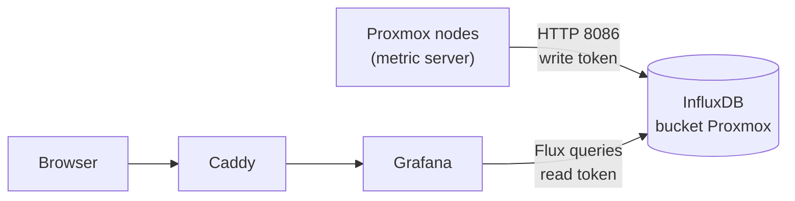

# Monitoring: InfluxDB + Grafana

| | |
|---|---|
| **Purpose** | Time-series metrics for the Proxmox cluster: CPU, RAM, disk and network for every node, VM and LXC, graphed in Grafana |
| **Runs on** | InfluxDB: LXC `124` on `elitedesk-worker`. Grafana: LXC `123` on `elitedesk-worker` |
| **IP / port** | InfluxDB `<influxdb-ip>:8086`, Grafana `<grafana-ip>:3000` (see the [static-address table](../networking/README.md#static--reserved-addresses)) |
| **Hostname** | `influxdb.hydralab.lan`, `grafana.hydralab.lan` (via [Caddy](../networking/reverse-proxy.md)) |
| **Version** | InfluxDB 2.x, Grafana 13.x |
| **Data location** | InfluxDB `/var/lib/influxdb/`; Grafana `/var/lib/grafana/` |
| **Backups** | TODO: |
| **Credentials** | `<see password manager>` (InfluxDB admin, one scoped token per writer/reader) |

## Install / config notes

Both LXCs were installed with the community-scripts.org Proxmox helper scripts (Debian).

### InfluxDB

| Item | Setting |
|---|---|
| Organization | `local` |
| Buckets | `Proxmox` (30-day retention), `OPNSense` (30-day retention, not written to yet) |
| Disk | 40 GB (grown from 8 GB on 2026-11-25) |
| Tokens | One per job, each scoped to the bucket(s) it needs: Proxmox (write `Proxmox`), OPNsense (write `OPNSense`), Grafana (read both). An all-access operator token is kept for admin work only |

### Proxmox metric server

**Datacenter → Metric Server**, one cluster-wide InfluxDB entry: protocol **HTTP**, port `8086`, organization `local`, bucket `Proxmox`, the Proxmox write token. The server is set by IP (`<influxdb-ip>`), not by name, because the nodes don't trust the internal CA. Proxmox stores the token under `/etc/pve/priv/`.

### Grafana

| Item | Setting |
|---|---|
| `grafana.ini` | `domain` / `root_url` set to `grafana.hydralab.lan` |
| Data source | `influxdb`: Flux, `http://<influxdb-ip>:8086/`, organization `local`, default bucket `Proxmox`, Grafana read token, basic auth off |

## Dashboards

| Dashboard | Source | Shows |
|---|---|---|
| **Proxmox Nodes & Guests** | Built for the lab. JSON: [`dashboards/proxmox-nodes-guests.json`](dashboards/proxmox-nodes-guests.json) | All-node CPU/RAM overview, then a section per node (picked with a **Node** variable): CPU/RAM gauges, CPU/RAM over time, a table of every VM/LXC (status, CPU %, cores, RAM %, RAM used, RAM limit), and per-guest CPU and RAM charts |
| **Proxmox VE Cluster [Flux]** | Community dashboard, imported | Cluster-wide Proxmox view written in Flux |

To restore: Grafana **Dashboards → New → Import**, upload the JSON. Its panels reference the data source by UID; if the data source is recreated, update the UID in the JSON first.

### Reading the numbers

| Value | Meaning |
|---|---|
| Node CPU / RAM | Accurate, from the host's point of view |
| Guest CPU % | Share of **that guest's own cores**, not the node's |
| LXC RAM | Accurate |
| VM RAM | **Includes the guest's file cache** (Proxmox gets `total − free` from the balloon driver), so busy VMs read close to 100%. Real use: `qm guest exec <vmid> -- free -h` (needs the QEMU guest agent) |

## Dependencies

- [Caddy](../networking/reverse-proxy.md) and the [Unbound overrides](../dns/README.md#hydralablan-overrides) for both names.
- The Proxmox metric server for all data.

## Firewall / access

LAN only. The Proxmox nodes write to InfluxDB directly by IP; users reach both web UIs through Caddy.

## Upgrade procedure

TODO:

## Known issues

- VM memory reads high because of file cache (see [Reading the numbers](#reading-the-numbers)).
- Data only goes back to 2026-11-25.
