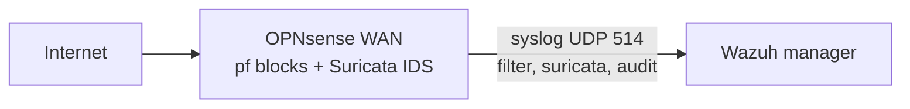

# Wazuh SIEM

| Item | Value |
|---|---|
| Manager | `<wazuh-ip>` (static DHCP mapping). Agents must use the IP: `wazuh.hydralab.lan` points at Caddy, which only carries web traffic |
| Runs on | LXC `118` on `elitedesk-worker` |
| Version | 4.x (manager and agents) |
| Dashboard | `https://wazuh.hydralab.lan` (via the [Caddy reverse proxy](../networking/reverse-proxy.md)) |

## Ports

| Port | Proto | Purpose |
|---|---|---|
| 1514 | TCP | Agent event traffic |
| 1515 | TCP | Agent enrollment |
| 55000 | TCP | Wazuh API |
| 443 | TCP | Dashboard |
| 514 | UDP | Syslog from OPNsense only (`allowed-ips` = `<opnsense-ip>`) |

Any segment with agents needs 1514 and 1515 allowed to `<wazuh-ip>`. Untrusted VLANs (like VLAN 20) intentionally can't reach it.

## Agents

| Host | OS | Notes |
|---|---|---|
| `HydraServerMox` | Debian 13 (Proxmox node) | Agent `003`, `<hydraserver-ip>` |
| `nuc-worker` | Debian 13 (Proxmox node) | Agent `004`, `<nuc-ip>` |
| `prodesk-worker` | Debian 13 (Proxmox node) | Agent `002`, `<prodesk-ip>` |
| `elitedesk-worker` | Debian 13 (Proxmox node) | Agent `001`, `<elitedesk-ip>` |
| `WIN-DC01` | Windows Server 2019 (DC) | Agent `009`, `<dc01-ip>`. Enrolled 2026-10-30 |
| `WIN-DC02` | Windows Server 2019 (DC) | Agent `008`, `<dc02-ip>`. Enrolled 2026-10-30 |

## OPNsense log source

Added 2026-11-25. OPNsense has no agent; it sends syslog to the manager.



| Item | Setting |
|---|---|
| OPNsense remote logging | **System → Settings → Logging → Remote**: UDP(4) to `<wazuh-ip>:514`, applications `filter`, `suricata`, `audit`. RFC5424 off |
| OPNsense default block logging | **Firewall → Settings → Advanced → Log packets matched from the default block rules** on |
| Suricata (IDS) | **Services → Intrusion Detection**: on WAN, Hyperscan, syslog alerts and eve syslog output on, ET Open rulesets, daily rule update. TODO: record the exact rulesets selected |
| Manager input | `<remote>` block in `/var/ossec/etc/ossec.conf`: `syslog`, UDP `514`, `allowed-ips` `<opnsense-ip>`, `local_ip` `<wazuh-ip>` |

### Detections

| Event | Rule | Source |
|---|---|---|
| Many firewall blocks from one source (port scan) | `87702` | Stock pfSense rules (OPNsense `filterlog` uses the same format). |
| Suricata alert | `86600`-series (e.g. `86601`) | Stock Suricata rules, enabled by a local decoder (below) |
| SSH login failure on OPNsense | `5760`, brute-force rules on repeats | Stock sshd rules |
| OPNsense web GUI login failure | `100600` | Local rule |
| Repeated GUI login failures (brute force) | `100601` | Local rule |

### Local decoder and rules

- `/var/ossec/etc/decoders/local_decoder.xml`: a decoder named `json` for `program_name` `suricata`. OPNsense sends Suricata's eve JSON behind a syslog header, which the stock JSON decoder doesn't pick up; naming the decoder `json` lets the stock Suricata rules apply.
- `/var/ossec/etc/rules/local_rules.xml`: rules for GUI login failures. OPNsense GUI login failures arrive as program `audit` and are otherwise matched by the Solaris BSM decoder at level 0 (silently dropped).

Test with `/var/ossec/bin/wazuh-logtest` and a sample line before restarting the manager.

### Email alerts

Added 2026-11-25. High-severity alerts are emailed to Ethan.

| Item | Setting |
|---|---|
| Wazuh | Email notification on, sent through `localhost` |
| Relay | Postfix on the Wazuh LXC, loopback only, relaying to Gmail on port 587 with TLS required. Wazuh's mailer can't authenticate itself |
| Credential | Gmail app password, `<see password manager>`, stored root-only in `/etc/postfix/sasl_passwd`. Revoking it at Google stops the emails without affecting the account |

## Checking agent connectivity

Agents need TCP `1514` (events) and `1515` (enrollment) to the manager. From a Windows agent:

```powershell
Test-NetConnection <wazuh-ip> -Port 1515
Test-NetConnection <wazuh-ip> -Port 1514
```
